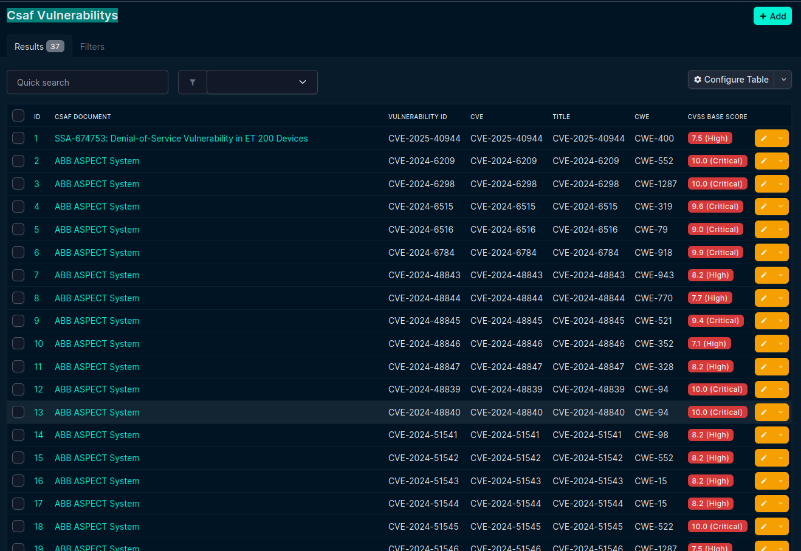
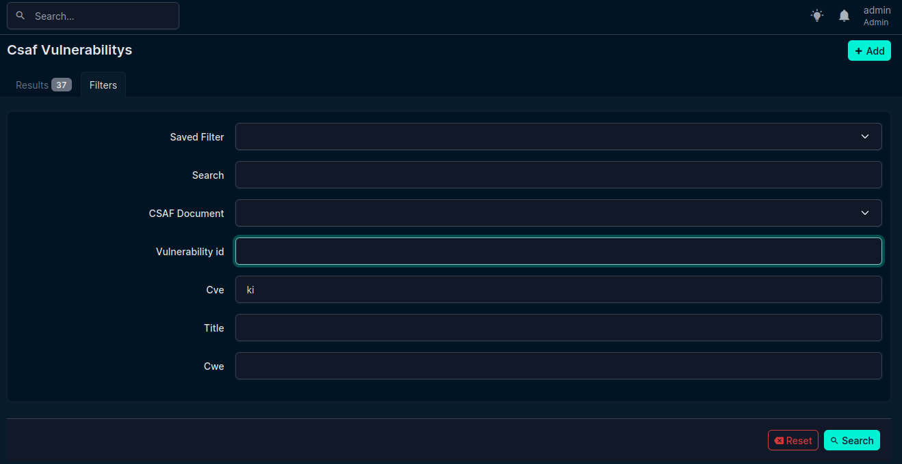
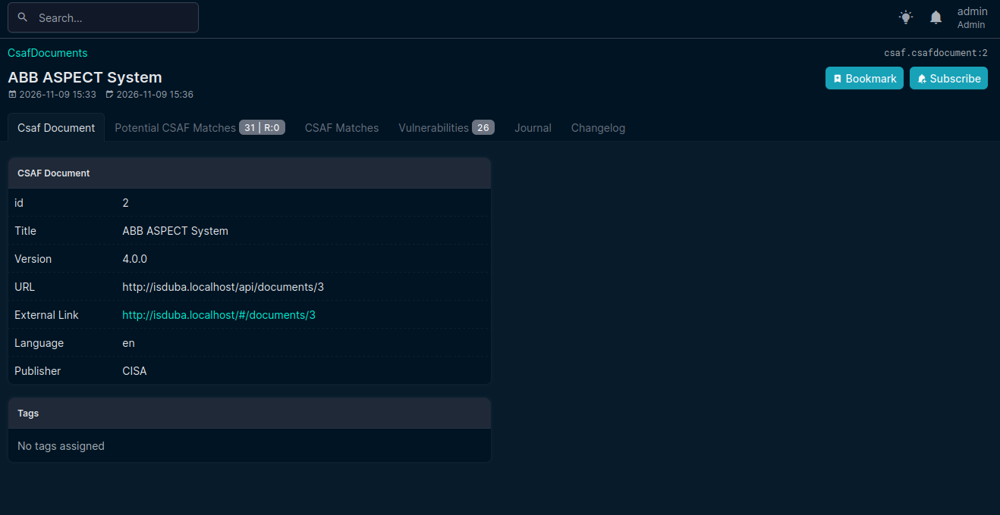
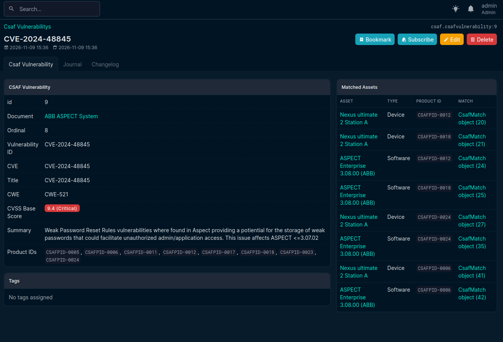

Workflow
=========

Besides the tutorial, this section describes the intended workflow of the Matching Agent and its components.

.. note::
    At the moment, it is the intended workflow

CSAF Vulnerabilitys
--------------------

The user access ``/plugins/csaf/csafvulnerability/`` and get :ref:`the overview of the CSAF Vulnerabilities startpage <vul-overview>`.

   Overview of the CSAF Vulnerabilities startpage in NetBox-Plugin.

Thinks to check when looking at the table

- are vul id CVE und title allways equal?
- Besides the CSAF document title the id should be used also

To be discussed
~~~~~~~~~~~~~~~

- Should be all vulnerabilities be displayed or only those with potential and confirmed matches? Here count of matches should be displayed in the table.
- standard view table: vulnerability id, title, cve, cwe, #potential matches, #confirmed matches, CSAF document title, CSAF document id

What to check 

- configura table
- Check filter
- 
- expectations when looking at the table and selection each entry. 

.. code-block:: json

    "title": "ABB ASPECT System",
    "tracking": {
      "current_release_date": "2024-12-05T00:30:00.000000Z",
      "generator": {
        "date": "2024-12-06T05:34:56.134000Z",
        "engine": {
          "name": "CISA CSAF Generator",
          "version": "1.0.0"
        }
      },
      "id": "ICSA-25-007-01",
      "initial_release_date": "2024-07-03T00:30:00.000000Z",

Filter Otions
~~~~~~~~~~~~~~

   Filtering vulnerability startpage

The filterpage should be standardized and used along the plugins

  .. list-table:: Field weights (overall score)
   :header-rows: 1
   :widths: 40 10 40

   * - Field
     - Type
     - Reason
   * - ``Saved Filter``
     - List
     - Standard
   * - ``Search``
     - Free text field
     - Standard
   * - ``CSAF Document``
     - List ⚠️ or allow to search for partial 🔍  
     - Standard
   * - ``Vulnerability id``
     - List ⚠️ or allow to search for partial 🔍  
     - Standard  
   * - ``CVE``
     - List ⚠️ or allow to search for partial 🔍  
     - Standard   
   * - ``Title``
     - List ⚠️ or allow to search for partial 🔍  
     - Standard   
   * - ``CWE``
     - List ⚠️ or allow to search for partial 🔍  
     - Standard 
    
  
Expectation of choseable entries 
~~~~~~~~~~~~~~~~~~~~~~~~~~~~~~~~~

   Standard view of CSAF document

the table of CSAF documents should be modified

- document ID under the title of the document ⚠️
- url and link as plain text 🔍  

- further use gets confusing...

Specific Vulnerability
----------------------

   This need work...
