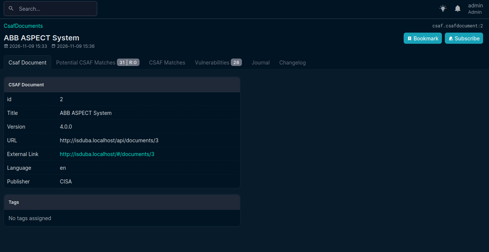

.. _csafdocuments:

CSAF Documents
==============

   Standard view of CSAF document

the table of CSAF documents should be modified

- Expected: Similar table like the http://netbox.localhost/plugins/csaf/csafdocument/
- .. todo:: document ID under the title of the document
- .. todo:: url and link as plain text necessary?

Tabs  

1. ``CSAF Documents``: /plugins/csaf/csafdocument/4/ :ref:`csafdocuments`
2. ``Potential Matches``: /plugins/csaf/csafdocument/4/csafmatchesnew/ :ref:`potential-matches`
3. ``Confirmed Matches``: /plugins/csaf/csafdocument/4/csafmatches/ :ref:`confirmed-matches`
4. ``Vulnerabilities``: /plugins/csaf/csafdocument/4/vulnerabilities/ :ref:`vulnerability`
