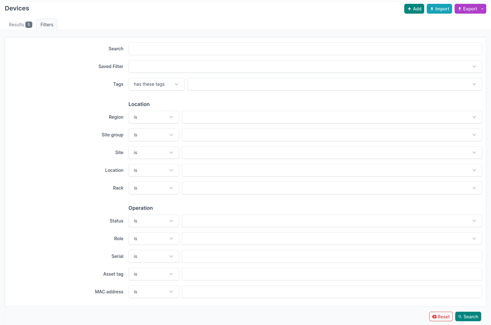
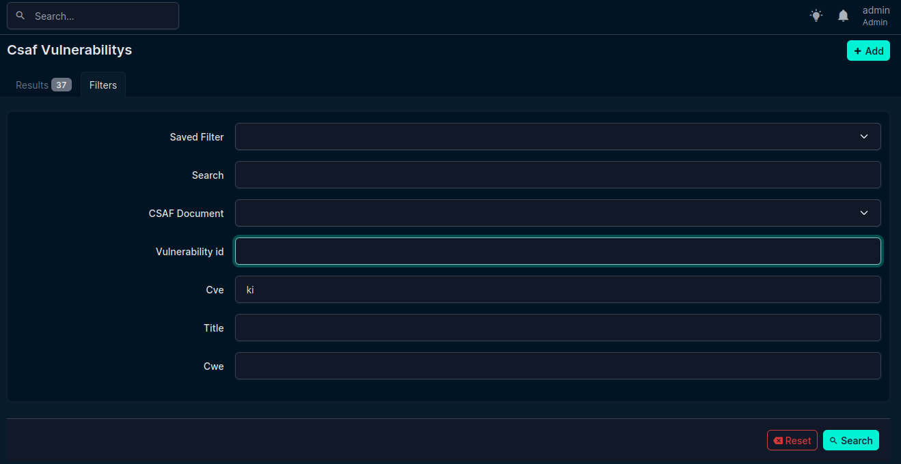

Filters Overview
================

NetBox provides a standard filter mask, where the options can be 

- **Free Text**: [is, is not, contains, start/ends with, equals, matches pattern]
- **List1**: [is, is not]
- **List2**: [is, is not, is empty, is not empty]
- **Bool**: [Yes, No]

   Standard filter of netbox object

Software
--------

.. list-table:: filter-matches-software
  :header-rows: 1
  :widths: 15 10 20

  * - Field
    - Type
    - Task
  * - ``Saved Filter``
    - List
    - None
  * - ``Search``
    - Free Text
    - keep it?
  * - ``Device``
    - List1 
    - Device installed on?
  * - ``Name``
    - List1
    - change Name to Name of Software
  * - ``Software``
    - List1
    - .. todo:: add document id to it like in figure shown below
  * - ``CVE``
    - FreeText
    - Capital letters
  * - ``Version``
    - Free text
    - keep it simple

This view does not belong to software?

.. _fig-filter-software:

  .. figure:: images_workflow/filter-software.png
    :width: 550px
    :align: center
    :name: filter-software

    This filter shows additional information when selecting device

.. _filter-vul-startpage:

Filter Options
--------------

   Filtering vulnerability startpage

The filterpage should be standardized and used across the plugins

  .. list-table:: Vulnerability filter
   :header-rows: 1
   :widths: 15 10 10

   * - Field
     - Type
     - Add Task
   * - ``Saved Filter``
     - List
     - None
   * - ``Search``
     - Free Text
     - keep?
   * - ``CSAF Document``
     - List1
     - None
   * - ``Vulnerability id``
     - List1
     - None  
   * - ``CVE``
     - FreeText
     - Capital letters  
   * - ``Title``
     - List1
     - None   
   * - ``CWE``
     - FreeText
     - Capital letters  

The filter for matches needs more care. This should be postbone until the new
algorithm is at place. There, score and description have to be revised. 

  .. list-table:: Match filter
   :header-rows: 1
   :widths: 10 10 25

   * - Field
     - Type
     - Add Task
   * - ``Saved Filter``
     - List
     - None
   * - ``Search``
     - Free text
     - :ref:`Error<error-search>`
   * - ``Device``
     - List2 
     - (add document id, see :ref:`Filter Software<fig-filter-software>`)  
   * - ``Module``
     - List2
     - (add document id, see :ref:`Filter Software<fig-filter-software>`)  
   * - ``Software``
     - List2
     - (add document id, see :ref:`Filter Software<fig-filter-software>`)    
   * - ``CSAF Document``
     - List2
     - (add document id, see :ref:`Filter Software<fig-filter-software>`)  
   * - ``Minimum Score``
     - N/A
     - .. deprecated:: v2.0.0-alpha
   * - ``Max Score``
     - N/A
     - .. deprecated:: v2.0.0-alpha
   * - ``Description``
     - N/A
     - .. deprecated:: v2.0.0-alpha