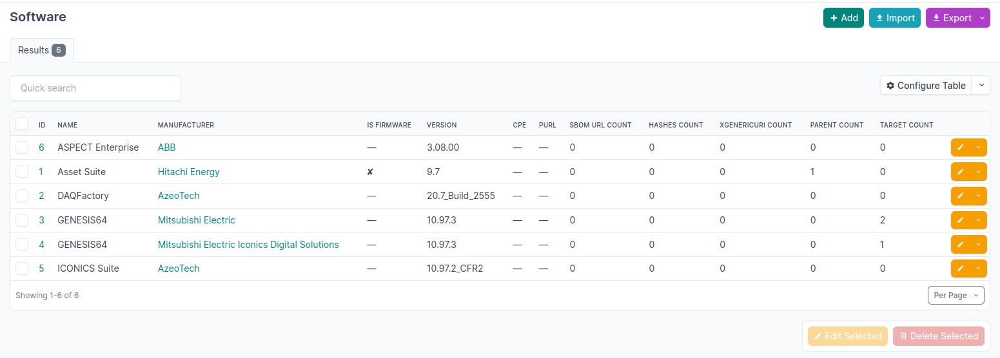

View by type
=============

The view of Device|Modules|Software with Matches are called by http://netbox.localhost/dcim/modules/withmatches/.

The standard view is similar without the match counts http://netbox.localhost/dcim/modules/

The question is if it would be better to combine this to views.

Software
---------

   
   Overview of matches with software

- Name should be linked also to http://netbox.localhost/plugins/d3c/software/<int>/ page
- also add columns like 
- delete count in header to safe space

- Getting counts in one column with [#,#,#,#,#,]?
- Cpe 	Purl 	SBOM url Count 	Hashes Count 	XGenericUri Count 	Parent Count 	Target Count 	

Combine views

- http://netbox.localhost/dcim/modules/withmatches/
- http://netbox.localhost/dcim/modules/

Data Model
^^^^^^^^^^

- https://github.com/DINA-community/D3C-Netbox-plugin/pull/137

Testing workflow...

