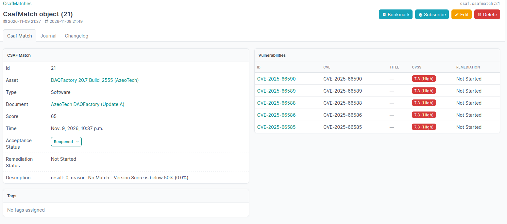
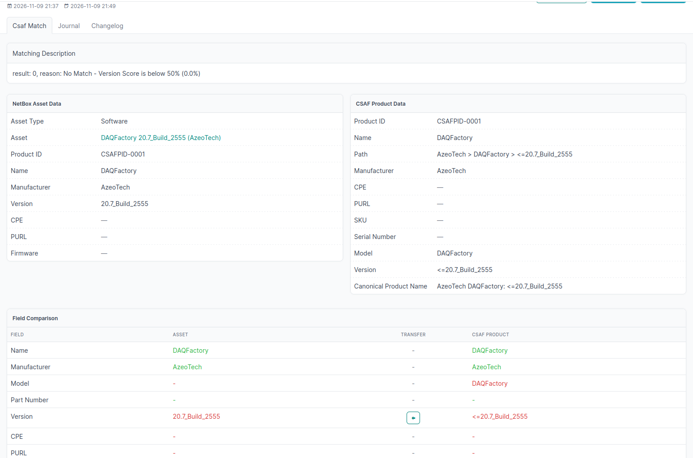

.. _confirmed-matches:

Matches
=======

The table workflow is similar to :ref:`potential matches<potential-matches>`

Optimization
^^^^^^^^^^^^

- Asset and Type in Table should be used as filter order also
- For Acceptance status the drop down list should be modified not listing "New"
- The inline Reopen option also use this name instead of "renew"
- .. todo:: what/how is quick search doing?
- Fast option "x" should by "Delete" or "False Positive" not "rejected"
- .. todo:: Delete equals false positive?

Outdated matches
----------------

- If all vulnerabilities of an asset are completed, the match get the status "solved"
- If by processing the vulnerabilities the matching reason might get outdated
  - check in comparison if the asset has changed since the matching time by using the changelog information
  - put an icon to this attribute value and the link to the changelog

.. _csafmatch-object:

CSAF-Match Object
------------------

   Information about a specific CSAF-Match object

Here, the information about the match should be displayed. The information about the vulnerabilities are distracting and should be removed.

.. _match-comparison:

Match comparison
-----------------

   Comparison of different match options

:ref:`fig:csafmatch-object` and :ref:`fig:match-comparison` have to be combined into one view by add missing information about the match to the comparison view. The information about the vulnerabilities are distracting and should be removed.
This is the option to set the acceptance Status.
   