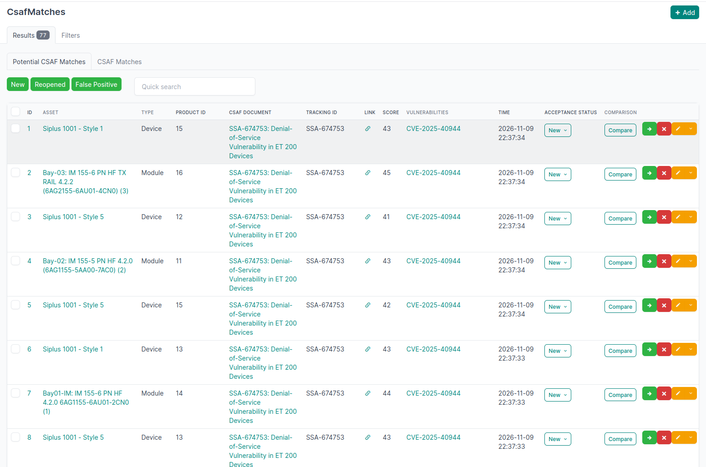
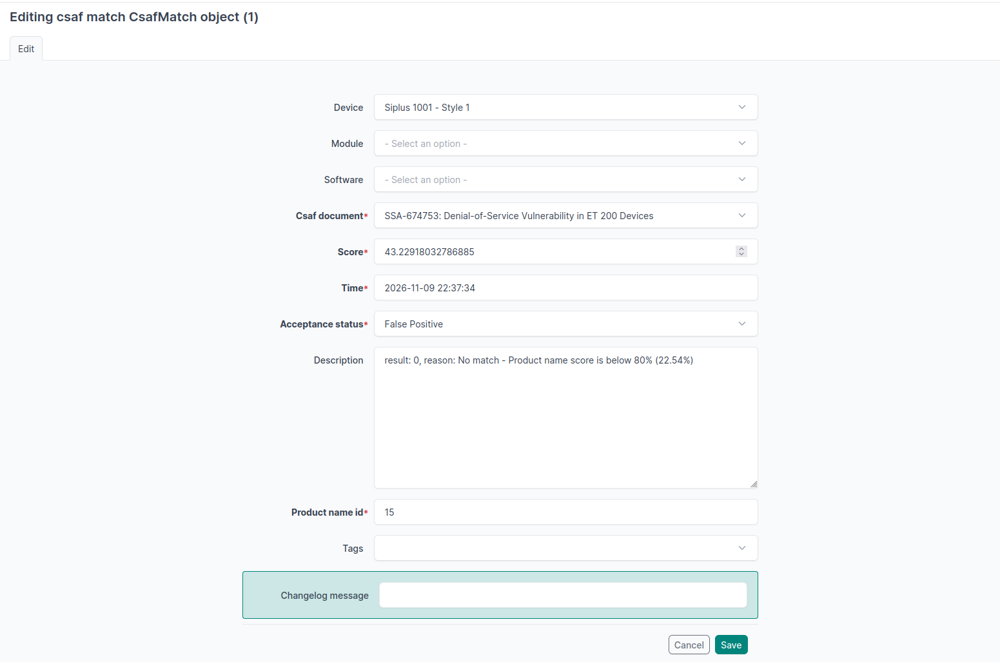

.. _potential-matches:

Potential Matches
=================

.. _csafmatch-overview:

CSAF-Match Object
------------------

   Overview of potential matches

The user can filter the potential matches separately by the extra tabs "NEW" "Reopened" and "False Positive". By clicking it gets grey (hidden) or green (show).

Optimization
^^^^^^^^^^^^

- Asset and Type in Table should be used as filter order also
- For each given Acceptance status the drop down list should be modified:
  - New:  False Positive and Confirmed
  - Reopened: False Positive and Confirmed
  - False Positive: Reopened, Confirmed
- In case of acceptance status of False Positive option Reopened should be mouse over also named so instead of "renew"
- .. todo::  what/how is quick search doing?
- Fast option "x" should by "Delete" or "False Positive" not "rejected"
- .. todo:: Delete equals false positive 

.. _error-search:

Server Error when using the search option in the filter search. It is not relevant if other fields are used.
Here the error for two different request which yielded the above error:

.. code-block:: text

    Unsupported lookup 'name__icontains' for ForeignKey or join on the field not permitted.
    GET http://netbox.localhost/plugins/csaf/csafmatch/?q=Modicon&device_id=5&maxscore=0.4
    GET http://netbox.localhost/plugins/csaf/csafmatch/?q=sf

Editing Matching
----------------

http://netbox.localhost/plugins/csaf/csafmatch/1/edit/?return_url=/plugins/csaf/csafmatch/

   Edit a (potential) match

This view/option should be removed entirely.