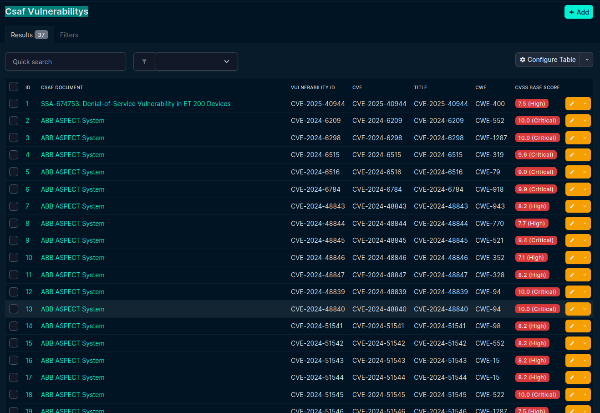
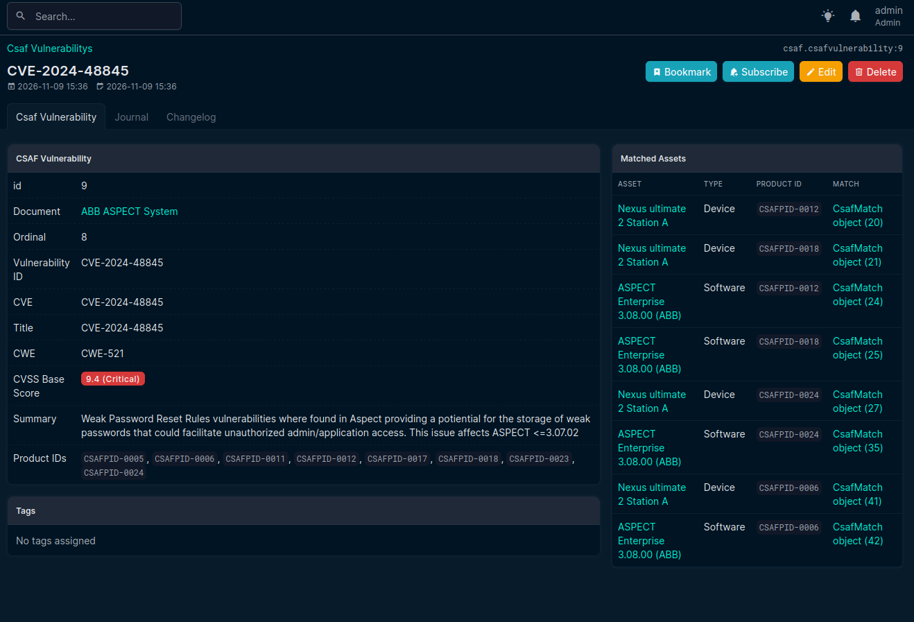

.. _vulnerability:

CSAF Vulnerabilities
====================

The user access ``/plugins/csaf/csafvulnerability/`` and get :ref:`the overview <vul-overview>` of the CSAF Vulnerabilities startpage.

   Overview of the CSAF Vulnerabilities startpage in NetBox-Plugin.

This view shows all vulnerabilities from all CSAF documents that have at least a possible match. The user can get more information about

- a specific :ref:`CVE<cve>` 
- .. warning:: linking missing
- a CWE: 
- .. todo:: Are there information available to display?
- the corresponding :ref:`CSAF Documents<csafdocuments>`

The user can filter the vulnerabilities by using the :ref:`filter options <filter-vul-startpage>`.

Optimization
------------

- Are vul id CVE und title always equal?
- Should be all vulnerabilities be displayed or only those with potential and confirmed matches? Here only a count of matches should be displayed in the table.
- Standard view table: vulnerability id, title, cve, cwe, #potential matches, #confirmed matches, CSAF document title, CSAF document id
- Besides the CSAF document title the id should be used also (see code block below)

.. code-block:: json

    "title": "ABB ASPECT System",
    "tracking": {
      "current_release_date": "2024-12-05T00:30:00.000000Z",
      "generator": {
        "date": "2024-12-06T05:34:56.134000Z",
        "engine": {
          "name": "CISA CSAF Generator",
          "version": "1.0.0"
        }
      },
      "id": "ICSA-25-007-01",
      "initial_release_date": "2024-07-03T00:30:00.000000Z",

.. _cve:

CVE
---

.. todo:: Is the title necessary? 🔍

Here, instead of a tab, the possible matches are displayed directly beside the CVE information. 
.. warning:: wrongly displayed as Matched Assets

The user can click on a specific match to view more details about it.

